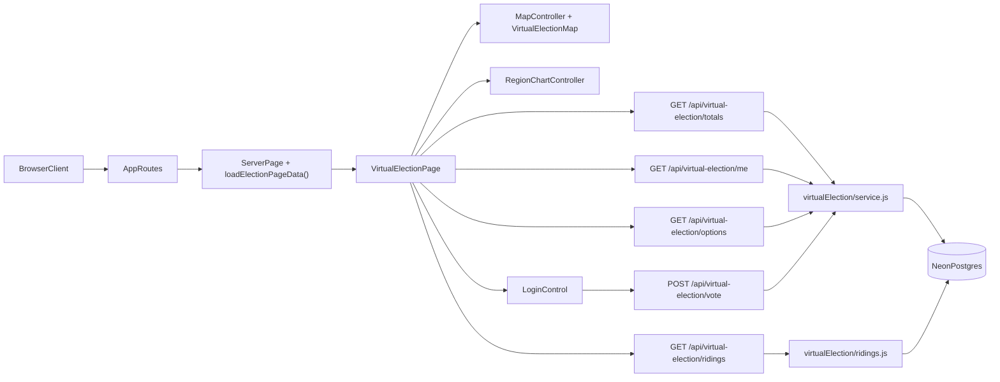
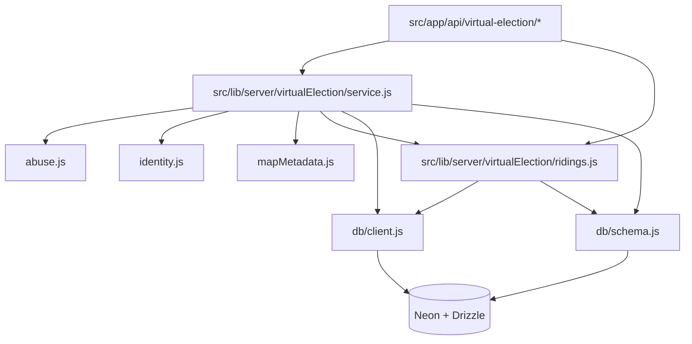
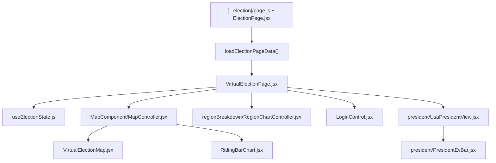
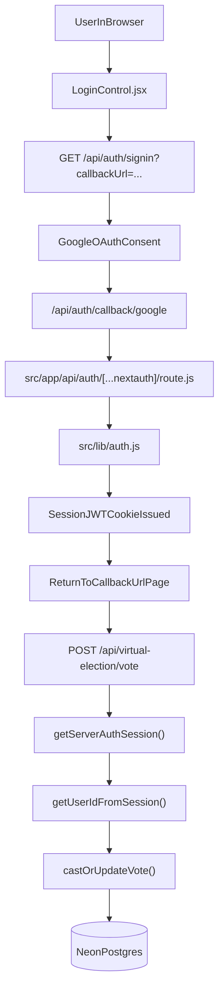

https://www.virtualelection.live/

# Virtual Election (Standalone Next.js Platform)

Standalone extraction of Poliwave Virtual Election into React + JavaScript + Next.js.

## What is included

- Authenticated one-vote-per-user virtual election flow
- API routes: `vote`, `totals`, `me`, `ridings`
- Atomic PostgreSQL aggregate updates (pre-aggregated country result tables)
- Regional breakdown charts and 15s refresh polling
- Security checks: origin check, rate limit, optional CAPTCHA

## Tech stack

- Next.js (App Router, JavaScript)
- Auth.js / NextAuth (Google OAuth)
- Drizzle ORM + Neon Postgres
- Recharts for regional visualizations

## Quick start

1. Install dependencies:

```bash
npm install
```

2. Copy environment template:

```bash
copy env.example .env.local
```

3. Fill `.env.local` with your Neon and Google OAuth values.

4. Run migrations:

```bash
npm run db:migrate
```

5. Start dev server:

```bash
npm run dev
```

Open `http://localhost:3000/`.

---

## Neon database initialization (new account)

### 1) Create Neon project

- Create a new Neon project and database from dashboard.
- Copy the pooled connection string.

### 2) Configure `.env.local`

Required:

- `DATABASE_URL`
- `AUTH_SECRET`
- `AUTH_URL`
- `AUTH_GOOGLE_ID`
- `AUTH_GOOGLE_SECRET`

Optional hardening:

- `VIRTUAL_ELECTION_ALLOWED_ORIGINS`
- `RECAPTCHA_SECRET_KEY`
- `VIRTUAL_ELECTION_RATE_WINDOW_MS`
- `VIRTUAL_ELECTION_RATE_MAX`
- `VIRTUAL_ELECTION_BURST_WARN_THRESHOLD`
- `VIRTUAL_ELECTION_DEADLINE_ISO`
- `ALLOW_SCOPE_FALLBACK` (set `true` only in local dev/test if riding-scope base tables are unavailable)
- `VIRTUAL_ELECTION_TOTALS_CACHE_SECONDS` (Australia only; shared-cache TTL in seconds for `GET /totals` and `GET /irv`, default `10`, `0` disables the shared cache)

### 3) Run schema migration

```bash
npm run db:migrate
```

### 3.1) Seed election-scoped options (recommended)

```bash
npm run db:seed:options
```

This seeds:

- `elections` (active scope metadata)
- `parties` (authoritative party IDs)
- `election_parties` (allowed parties for the election scope)
- `election_districts` (for every country whose config has `districts.source: 'divisions'` or `districts.seed: true`, e.g. the 150 Australian divisions, the 299 German constituencies and the 650 UK constituencies)

The migrations create:

- `virtual_election_votes` (migration `0006` adds the nullable `ranking_key` column used for ranked ballots)
- `RidingResults.riding_result` (migration `0008`): first-choice counters for every country, keyed by `country`
- `RidingResults.ballot_result` (migration `0008`): aggregated full rankings used for IRV, keyed by `country`
- Legacy per-country tables (`canada_`, `usa_`, `uk_`, `australia_`, `germany_riding_result`, `australia_ballot_result`): created by migrations `0004`-`0007`; migration `0008` copies their rows into the two tables above and the app no longer uses them
- `elections`
- `parties`
- `election_parties`

### 4) Verify tables

Run in Neon SQL editor:

```sql
select * from virtual_election_votes limit 5;
select country, count(*), sum(votes) from "RidingResults".riding_result group by country;
select * from "RidingResults".ballot_result limit 5;
```

### 5) (Optional) clear virtual election data

```sql
truncate table virtual_election_votes restart identity;
truncate table "RidingResults".riding_result;
truncate table "RidingResults".ballot_result;
```

To recompute the counters from the vote rows at any time (for example after migrating), run `node scripts/rebuild-virtual-election-totals.mjs`.

---

## Architecture

### End-to-End Request Flow



### Server Layering



### Frontend Composition



## Google OAuth workflow

This project uses Auth.js/NextAuth with Google as the provider. The sign-in button is rendered on the client, while session validation is enforced in server routes before vote operations.



### File-level mapping

1. Client sign-in link: `src/lib/components/virtualElection/LoginControl.jsx`
2. Auth route handler: `src/app/api/auth/[...nextauth]/route.js`
3. Google provider config: `src/lib/auth.js`
4. Session enforcement in vote API: `src/app/api/virtual-election/vote/route.js`
5. User identity normalization: `src/lib/server/virtualElection/identity.js`

## Data model

- `virtual_election_votes`: canonical user vote row (`user_id + scope` unique)
- `RidingResults.riding_result`: pre-aggregated first-choice counters, one row per `country + riding_id + party + district + year` (first preferences for ranked scopes)
- `RidingResults.ballot_result`: one row per distinct full ranking per district (`ranking_key` such as `ALP>GRN>LNP>...`), the input for IRV counting in ranked scopes- `virtual_election_votes.ranking_key`: the voter's full ranking for ranked-ballot scopes (`party` holds the first preference, so existing readers keep working)
- Australian division IDs are the 5-letter `code` values of the `au-gen` layer in `static/ridingMaps/Austrilia.pmtiles` (for example `ADELA`, `KSMIT`)
- USA district IDs use canonical keys: `us-fed-2025-<STATEFP>-<DISTRICT_OR_AL>`
- USA presidential state IDs use canonical keys: `US-PRES-2025-<FIPS>`

Vote API performs a single atomic SQL operation:

1. read previous vote
2. upsert current vote
3. decrement previous aggregate if changed
4. increment new aggregate

For ranked-ballot scopes (Australia) the same statement also moves the voter's ballot between rows of `ballot_result`; changing only the lower preferences updates the ballot table but leaves the first-preference counters untouched.

### Australia: preferential voting (IRV)

- Scope `au/fed/2025`, map `static/ridingMaps/Austrilia.pmtiles` (150 House of Representatives divisions), rendered with MapLibre GL + the `pmtiles` protocol (`MapComponent/PmtilesMap.jsx`).
- A ballot ranks all 7 parties exactly once (`ALP, LNP, GRN, IND, ONP, AFP, OTH`; the default ballot order is the shared display order). One ballot per user: voting again overwrites the previous ranking and division.
- Counting (`src/lib/virtualElection/irv.js`) is done on the server for every division on each `GET /totals` request: count first preferences; if a party has more than 50% it wins; otherwise the party with the fewest votes is eliminated and its ballots move to the next remaining preference; repeat. Elimination ties are broken by fewer first preferences, then by the party that is later in `IRV_TIE_BREAK_ORDER_BY_COUNTRY` (`ALP, LNP, GRN, IND, ONP, AFP, OTH`; independent of the display order). The client never runs IRV.
- Seats and map colors use the IRV winner; vote charts use first-preference totals.
- Division list, states and zoom bounding boxes live in `src/lib/data/auDivisions.json`. After replacing the pmtiles file run `node scripts/extract-au-divisions.mjs --check` (and `--write-bbox` to refresh bounds); `node scripts/verify-irv.mjs` verifies the counting logic.

### Adding a country

Every country runs the same workflow (scope -> options -> vote -> aggregate -> totals -> map/charts), so a country is pure configuration plus data files:

1. Create `src/lib/config/countries/<country>.js` (copy `germany.js` for a PMTiles map or `uk.js` for a TopoJSON map) and add it to `ELECTION_COUNTRIES` in `src/lib/config/electionCountries.js`. The file declares:
   - meta: `code`, `name`, `region`, `basePath`, `entryRoute`, `flag`, `home` card
   - `votingSystem` (`'single'` or `'preferential'`; preferential also needs `irvTieBreakOrder`) and `parties` (code -> name, short name, colors; reuse `SHARED_PARTIES.OTH` / `.IND`)
   - `map`: `renderer: 'maplibre'` (`asset`, `sourceLayer`, `nameProperty`, `view.bounds`) or `renderer: 'leaflet'` (`asset`, `idProperties`, `nameProperties`, `subnationalProperties`, `view`), plus `versionPrefix` and `regionKey`
   - `districts`: `{ source: 'divisions', divisions }` (committed JSON list, create it with a `scripts/extract-*-divisions.mjs`) or `{ source: 'map', seed }` (read from the TopoJSON map)
   - `regions`: `options` (or `fromDivisions: true`), optional `aliases`, and `resolve` rules (`'subnational'`, `'division'`, `{ prefix: ... }`)
   - `sites`: one entry per page (`district`, `year`, `route`, `pageTitle`, `historyLabel`, `seo`, optional `view` and `map` overrides)
2. Add the map file under `static/ridingMaps/` and the flag under `static/flags/`.
3. Run `npm run db:seed:options` (parties, scope and districts). No migration, page file, map adapter or region profile is needed: the routes, header, home page, sitemap, history page, API scopes, result rows, map adapter and region profile are all generated from the config.

The USA is the only country with custom code (`map.renderer`, `districts.source` and `regions.source` set to `'custom'`): its House and presidential maps compute district IDs from FIPS codes (`adapters/usa.js`, `profiles/usa.js`, `server/virtualElection/usRidings.js`).

### Party display order (all countries)

The written order of `parties` in a country config is irrelevant. `sortPartiesForDisplay()` (used by `getAllowedPartiesForScope()` and by the server when reading `election_parties`) orders every list the same way: alphabetical by full name (accent-insensitive), with independents (`IND`, `Independent`) and then `OTH` last. The IRV tie-break order is a separate `irvTieBreakOrder` so display ordering never affects counting.

Countries are listed alphabetically by name everywhere (header selector, home page cards, history page); the home page groups them by region, also alphabetical. The order of the imports in `electionCountries.js` does not matter. `DEFAULT_COUNTRY` (Canada) is the fallback for unknown routes/scopes and the default scope.
### Germany: constituency vote (FPTP)

- Scope `de/fed/2025`, map `static/ridingMaps/Germany.pmtiles` (layer `fed`, 299 Bundestag constituencies, 16 states), rendered by the same `PmtilesMap` as Australia but with plain single-choice voting like Canada/UK.
- Only the first vote (Erststimme) is simulated: one party per constituency, the plurality leader wins the seat (150 seats for a majority). The second vote and list seats are not simulated.
- Parties: `CDU` (CDU and CSU merged; short name "CDU/CSU"), `AFD`, `SPD`, `GRUNE`, `LINKE`, `BSW`, `FDP`, `SSW`, `OTH`. Party names are shown in German (for example "Bündnis 90/Die Grünen", "Südschleswigscher Wählerverband").
- Constituency IDs are the `code` values (the official constituency number as a string, `"1"`..`"299"`). Names, states and zoom bounding boxes live in `src/lib/data/deDivisions.json`. After replacing the pmtiles file run `node scripts/extract-de-divisions.mjs --write` to regenerate it and `node scripts/extract-de-divisions.mjs --check` to verify it against the tiles.
- API request/response shapes are unchanged; use `country=de&district=fed&year=2025`. Existing databases need `npm run db:migrate` (migrations `0007` and `0008`) and `npm run db:seed:options` before Germany works.

### France: Assemblée nationale, first round (FPTP)

- Scope `fr/fed/2024`, route `/france`, 567 circonscriptions (539 metropolitan + 28 overseas), plain single-choice voting; the bloc with the most votes in a circonscription leads it (284 seats for a majority). Only the first round is simulated, not the runoff.
- Blocs (2024 first-round nuances): `RN`, `NFP`, `ENS`, `LR`, `DVD`, `DVG`, `OTH`; names are French.
- Map: Leaflet reads `static/ridingMaps/France.json`, generated from the full-resolution `static/ridingMaps/France.geojson` by `node scripts/build-fr-map.mjs` (simplified; overseas constituencies are moved into inset boxes in the Atlantic west of Brittany, so their drawn position is not geographic). Re-run the script after replacing the GeoJSON; it also assigns names (`<département>, <n>e circonscription`) and the 13 metropolitan regions + `Outre-mer` used by the region dropdown.
- Constituency IDs are the `circ_id` values (e.g. `0101`, `97101`). Districts are read from the map file and seeded with `npm run db:seed:options`. No new migration (uses the generic result tables from `0008`); use `country=fr&district=fed&year=2024`.

---

## Project map

- `src/app/page.js`: intro homepage
- `src/app/sitemap.js`: XML sitemap route for search engine discovery
- `src/app/robots.js`: robots.txt route for crawler directives
- `src/lib/config/countries/*.js`: one config file per country (meta, parties and colors, map, districts, regions, pages); `sharedParties.js` holds `OTH` / `IND`
- `src/lib/config/electionCountries.js`: registry built from the country configs (`ELECTION_COUNTRIES`, `ELECTION_SITES`, party catalogue, lookups)
- `src/lib/config/virtualElection.js`: election rules derived from the registry (allowed scopes and parties, display order, IRV tie-break order, preferential scopes)
- `src/app/[...election]/page.js`: the single route for every election page (resolved from `ELECTION_SITES`; `/usa` redirects to its entry page; unknown paths 404)
- `src/lib/components/virtualElection/ElectionPage.jsx`: shared server component (page data loading, SEO intro) and `buildElectionMetadata()`
- `src/lib/components/virtualElection/MapComponent/adapters/index.js`: builds each country's map adapter from its `map` config (`createPmtilesAdapter.js`, `createTopoJsonAdapter.js`; `usa.js` is custom)- `src/lib/components/virtualElection/MapComponent/PmtilesMap.jsx`: generic MapLibre + PMTiles map surface (Australia, Germany); driven by adapter `sourceLayer` and `divisions`
- `src/lib/components/virtualElection/MapComponent/IrvRoundsPanel.jsx`: round-by-round preference count for the selected division
- `src/lib/components/virtualElection/RankedBallot.jsx`: drag-and-drop ranked-ballot control (`@dnd-kit`; mouse, touch long-press, keyboard)
- `src/lib/virtualElection/irv.js`: pure IRV counting module
- `src/lib/components/virtualElection/VirtualElectionPage.jsx`: client orchestrator
- `src/lib/components/virtualElection/Header.jsx`: shared country selector header
- `src/lib/components/virtualElection/LoginControl.jsx`: auth-aware vote controls
- `src/lib/components/virtualElection/MapComponent/VirtualElectionMap.jsx`: map surface
- `src/lib/components/virtualElection/MapComponent/adapters/usa.js`: USA house + president map adapter (`USA.json` + `us-atlas`)
- `src/lib/components/virtualElection/regionBreakdown/RegionSeatChart.jsx`: seat chart
- `src/lib/components/virtualElection/regionBreakdown/RegionVoteChart.jsx`: vote chart
- `src/lib/components/virtualElection/regionBreakdown/profiles/*`: builds each country's region profile from its `regions` config (`createRegionProfile.js`; `usa.js` is custom)
- `src/lib/server/virtualElection/mapAssets.js`: reads districts from a country's TopoJSON map (same property names as the map rendering), shared by the ridings API and the seed script
- `src/app/api/virtual-election/*`: API handlers
- `src/lib/server/virtualElection/service.js`: domain logic + atomic SQL
- `src/lib/server/virtualElection/loadElectionPageData.js`: shared page bootstrap loader
- `src/lib/server/virtualElection/abuse.js`: abuse protections

---

## Agent handoff notes

### Current state

- Core backend contracts and data model are ported.
- UI parity includes controls, totals, overwrite confirmation, regional filtering, and polling.
- `VirtualElectionMap.jsx` currently ships with a list-based selector as the extraction-safe default.

### Priority next tasks for agents

1. Replace list selector with full MapLibre/PMTiles riding map adapter.
2. Port exact tooltip behavior and locked-hover rendering from previous Svelte map.
3. Add test suite:
   - vote lifecycle (`created`, `updated`, `unchanged`)
   - concurrent/conflict behavior
   - auth + origin + rate limit errors
   - regional alias coverage (`NL`, `NB`, `YT`)
4. Promote in-memory rate limiter to shared store (Redis/Upstash) for multi-instance production.

### API contracts

- `POST /api/virtual-election/vote`
- `GET /api/virtual-election/totals`
- `GET /api/virtual-election/me`
- `GET /api/virtual-election/ridings`
- `GET /api/virtual-election/options`
- `GET /api/virtual-election/irv` (Australia only, see "Ranked-ballot scopes")


POST /api/virtual-election/vote
Casts or updates the authenticated user’s vote for one riding/party in the selected scope (country, district, year). Enforces auth, scope/party/riding validation, abuse checks, and returns updated me vote state.
GET /api/virtual-election/totals
Returns current aggregated virtual-election totals by riding for the selected scope. Each riding includes per-party totals, leader, intensity, and total votes.
GET /api/virtual-election/me
Returns the current authenticated user’s vote state for the selected scope (voted: false if not signed in or no vote exists).
GET /api/virtual-election/ridings
Returns the list of ridings available in the selected scope (code, name, subnational) for map/selector rendering.
GET /api/virtual-election/options
Returns authoritative election bootstrap options for the selected scope (`scopeId`, `countryCode`, `mapVersion`, `districtIdNamespace`, `allowedParties`, `ridings`, and UI rules). Clients should use this to render allowed UI choices; server remains the source of truth for enforcement.
For presidential scope, options also include `mode`, `regionKey`, `allocationRule`, and `electoralVotesVersion`. Options also include `votingSystem` (`"preferential"` for Australia, `"single"` otherwise).

#### Ranked-ballot scopes (Australia, `country=au`)

The contracts above are unchanged for Canada, UK and USA. For `country=au` they change as follows (additive, except that `ranking` replaces `party` on `POST /vote`):

- `POST /api/virtual-election/vote`
  - Purpose: cast or overwrite the user's ranked ballot for one division.
  - Request: `{ "country": "au", "district": "fed", "year": 2025, "ridingId": "ADELA", "ranking": ["ALP","LNP","GRN","IND","ONP","AFP","OTH"], "captchaToken"?: string }`. `ranking` must list every allowed party exactly once; the first entry is the first preference (`party` is ignored for `au`).
  - Response: `{ "success": true, "result": { "status": "created" | "updated" | "unchanged", "voted": true, "ridingId", "party", "ranking" }, "me": { "voted": true, "ridingId", "party", "ranking" } }`, where `party` is the first preference.
  - Errors: `400` `INVALID_RANKING` (missing, partial, duplicated or unknown parties), plus the existing `400/401/403/409/429/503` cases.
- `GET /api/virtual-election/totals`
  - Each riding row keeps `ridingId`, `totals`, `leader`, `intensity`, `totalVotes`. For `au`: `totals` and `totalVotes` are first-preference counts, `leader` is the IRV winner, `intensity` is the winner's share in the final count, and an additive `irv: { winner, firstPreferenceLeader, finalTwo: [{ party, votes }] }` is included.
  - Caching: for `au` the response is `Cache-Control: public, s-maxage=N, stale-while-revalidate=3N` with `N = VIRTUAL_ELECTION_TOTALS_CACHE_SECONDS` (default 10; `0` disables). The client adds a `fresh=<timestamp>` query param right after voting to bypass shared caches.
- `GET /api/virtual-election/me`
  - For `au`, a saved vote also returns `ranking` (full ordered list).
- `GET /api/virtual-election/irv?country=au&district=fed&year=2025&ridingId=ADELA` (new, `au` only)
  - Purpose: full preference count for one division.
  - Response: `{ ridingId, totalBallots, winner, firstPreferenceLeader, finalTwo, winnerShare, exhausted, rounds: [{ round, counts: { party: votes }, total, eliminated: party | null }] }`.
  - Errors: `400` `INVALID_SCOPE` (scope does not use ranked ballots), `400` `INVALID_RIDING`, `503` tables missing. Uses the same caching rule as `GET /totals`.

Current routes:

- `/` intro page
- `/canada` Canada federal virtual election
- `/usa` USA election selector
- `/usa/houseOfRepresentatives` USA House virtual election (`us/fed/2025`)
- `/usa/president` USA presidential virtual election (`us/pres/2025`)
- `/uk` UK parliament virtual election (`uk/fed/2025`)
- `/australia` Australia House of Representatives virtual election (`au/fed/2025`, ranked ballot)
- `/germany` Germany Bundestag constituency vote (`de/fed/2025`, FPTP)
- `/france` France Assemblée nationale first round (`fr/fed/2024`, FPTP)

Note: USA map currently uses direct AK/HI placement (insets can be added later).
Error semantics are aligned with prior implementation:

- `401` unauthenticated
- `400` invalid input/scope/party/riding
- `403` forbidden origin
- `409` vote window closed or conflict
- `429` rate limited
- `503` virtual election tables missing

---

## Deploy notes (Vercel + Neon)

- Set all env vars in Vercel project settings.
- Add production domain to `VIRTUAL_ELECTION_ALLOWED_ORIGINS`.
- Add production callback URL for Google OAuth.
- Run `npm run db:migrate` against production Neon DB before first launch (migration `0006` is required for Australia, `0007` for Germany, `0008` moves all counters to the shared `riding_result` / `ballot_result` tables), then `npm run db:seed:options`. Apply migrations before deploying code that depends on them; after `0008`, optionally run `node scripts/rebuild-virtual-election-totals.mjs` to recompute counters from the vote rows.
- `static/ridingMaps/Austrilia.pmtiles` and `static/ridingMaps/Germany.pmtiles` are read by the browser with HTTP Range requests; the host serving `/static/*` must support `Range` (the Next.js dev server does). The CSP in `next.config.mjs` allows `worker-src blob:` for MapLibre.
- The MapLibre worker is copied to `public/maplibre/` (git-ignored) by `scripts/copy-maplibre-worker.mjs`, which runs automatically via `predev` and `prebuild`. If you build with a custom command that skips `npm run build`, run `node scripts/copy-maplibre-worker.mjs` first.

test
